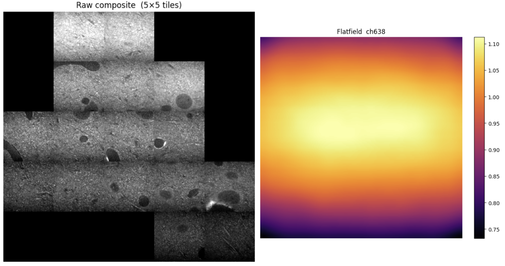
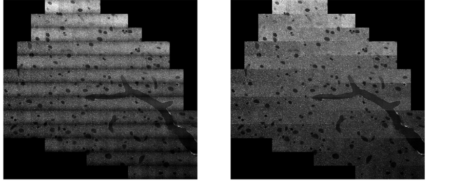
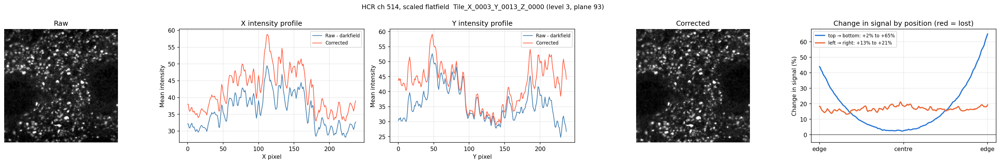
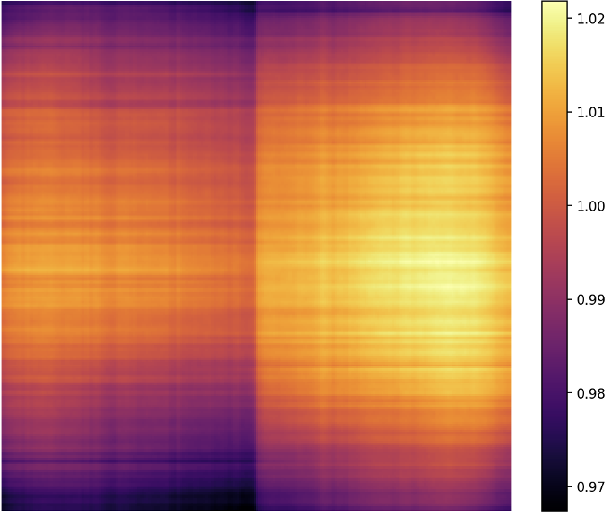
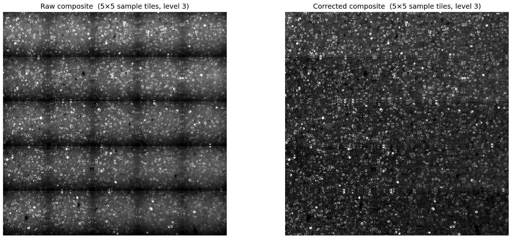

# aind-flatfield-correction

[](LICENSE)

[](https://github.com/semantic-release/semantic-release)


Flatfield estimation for microscopy tile datasets, built on
[BaSiCPy](https://github.com/peng-lab/BaSiCPy).

One run fits a single multiplicative flatfield for one channel from a bounded number of Z
planes taken from **every** tile in that channel. Every tile contributes: N tiles at one Z
index are N different regions seen through the same optics, and so are highly informative
about the `(y, x)` profile, whereas consecutive Z planes of a single tile are nearly
redundant. The image budget is therefore spent on tiles, not on Z.

## Flatfield Examples
We estimate the flatfields by smartly selecting slices from each tile in the dataset.


This is the result after applying flatfield to the tiles of a proteomics dataset.



In very low illumination datasets and lower wavelenght channels, we can even detect the difference in the intensity gains of the camera chips.


> **Note:** Technically speaking, we don't want to use the same darkfield for each side of the intensity gain, but this is good enough as an approximation and scientists as happy with the results.

## Installation

```bash
uv sync
```

Python 3.10 and 3.11 only. The upper bound comes from the pinned `numpy==1.24.2`, which
ships no cp312 wheel, and from `jax==0.4.23` requiring `numpy>=1.26` on Python 3.12.

> **Note:** `aind-large-scale-prediction`, which provides the OME-Zarr reader, is
> installed from its `unpinned-versions` branch rather than from PyPI: the released 1.0.0
> hard-pins `numpy==1.26.4` and `zarr==2.18.0`, both of which conflict with the versions
> pinned here. The dependency is a direct git reference, so `uv sync` and
> `pip install -e .` both pick it up.

For development, `uv sync` already includes the dev group. Without `uv`:

```bash
pip install -e . --group dev   # --group needs pip >= 25.1
```

## Quick start

`base_path` is **one channel's folder**: every OME-Zarr directly inside it is treated as a
tile of the same channel. Nothing is inferred from tile names, so to estimate several
channels you run the command once per channel folder.

```bash
python -m aind_flatfield_correction.core.basicpy.estimate \
    s3://aind-open-data/HCR_800792_2026-03-25_13-00-00/SPIM/ch_405 \
    --pyramid-level 3 \
    --darkfield-value 90 \
    --validate \
    --output-folder ./flatfields
```

If the tiles for several channels sit in one flat folder, select a subset with a regular
expression and name the run yourself:

```bash
python -m aind_flatfield_correction.core.basicpy.estimate <base_path> \
    --tile-pattern '_ch_405\.ome\.zarr$' \
    --output-name ch405
```

Local paths work the same way as `s3://` ones.

## What it produces

Named after `--output-name`, or after the last segment of `base_path` if you omit it:

| Path | Contents |
|---|---|
| `flatfield_<name>.npy` | The fitted flatfield, at the estimation pyramid level, scaled so its 99.9th percentile is 1 (see step 8 below) |
| `flatfield_<name>_level0.npy` | The same flatfield resampled to full resolution, unless `--no-upsample` |
| `darkfield_<name>.npy` | The darkfield plane that was actually subtracted before fitting |
| `darkfield_<name>_level0.npy` | The darkfield at full resolution, unless `--no-upsample` |
| `flatfield_<name>.json` | Sidecar: solver config, chosen parameters, the pre-fit `checks`, the `plane_filter` record, search report, flatfield statistics, the plausibility verdict, the scaling applied, provenance, and the list of tiles used |
| `metadata/estimation.log` | The whole run's log |
| `metadata/tiles_<name>.json` | One record per tile that contributed to the fit |
| `<name>/*.png` | Inspection figures, only with `--validate` |

`darkfield_<name>.npy` holds the pedestal used for the fit rather than BaSiC's own
darkfield estimate — `get_darkfield` is off, so that estimate is all zeros, and the
pedestal is what an apply step needs.

Supply a measured darkfield; do not turn `get_darkfield` on to let BaSiC estimate it. On
dim HCR channels and on SmartSPIM channels BaSiC's own darkfield came out at 0–6 counts
against a measured camera dark of 90–104, both with the built-in configuration and with
basicpy's defaults: BaSiC can only separate the darkfield from the flatfield when the
images span a wide range of brightness, and the tiles of one channel do not. For dim
channels without recorded dark frames, build one from the data with the darkfield
builder (see [Building a darkfield for dim channels](#building-a-darkfield-for-dim-channels)).

Both levels are kept for each field: the estimation-level files are what was actually
fitted and are the reproducible artifacts, while the
full-resolution pair is what an apply step subtracts and divides by.

The full-resolution darkfield is built from the darkfield **as you supplied it**.

### Reproducing and diagnosing a run

The sidecar is self-contained, there is no separate provenance format to reconcile. Its
`provenance` block records the package version and git commit, the versions of every
dependency a result actually depends on (`BaSiCPy`, `jax`, `numpy`, `scikit-image`, …), the
full command line and **every** parsed argument, the sampling seeds, the resolved worker
and CPU counts, the platform and host, and the run's start, end and duration. A supplied
`--darkfield-image` is recorded with its SHA-256, so a silently swapped input is
detectable.

Two files sit alongside it in `metadata/`:

- **`estimation.log`** — every record the run emitted, including per-candidate entropies
  and worker tracebacks that otherwise exist only on the console. Attached to the root
  logger, so jax, dask and botocore warnings land there too. It inherits whatever logging
  configuration is already in place rather than imposing its own, this is useful if using personalized logging packages, such as .
- **`tiles_<name>.json`** — per tile: its name, probed `(Z, H, W)`, the Z indices actually
  loaded, the mean of those planes, and whether it was padded. A dead tile shows up as a
  mean near zero, and a tile smaller than the rest is flagged rather than silently
  contributing zeros to the fit.

Between the two, a bad flatfield can usually be diagnosed without re-running the
estimation.

## How it works

1. **Gather planes.** Every tile is probed for its shape, then `--max-fit-planes ÷ n_tiles`
   planes are streamed from each, taken from the middle 60% of Z. The stack ends
   zero-padded to the largest plane extent.
2. **Remove the sensor pedestal.** `raw = pedestal + signal × flatfield`. The offset is
   added after light collection, so it is not vignetted, and a multiplicative field must
   be estimated on the signal alone. Fitting on raw values squashes the apparent
   vignetting by `S / (P + S)` — 14× on a channel whose median raw value is 97 over a
   pedestal of 90 — and yields a near-unity, no-op flatfield.
3. **Check the fitting stack** (recorded in the sidecar's `checks` block; warnings only).
   Two conditions were found to decide whether a flatfield is valid:
   - *The darkfield matters.* The flatfield error is about the darkfield error divided by
     the signal. With a per-pixel `--darkfield-image`, `dark_error_ratio` is how far it is
     from a scalar relative to the signal (the median plane mean above the darkfield); above
     10% the darkfield decides the flatfield and must be accurate. It measured 25–150% on dim
     HCR channels, whose scalar-darkfield flats were worse than no flatfield, and about 1% on
     SmartSPIM channels. With a scalar darkfield the error cannot be measured, so a signal
     below 30 counts is flagged instead.
   - *The signal is concentrated.* The check fires on either of two signs, and records its
     verdict as `concentrated_signal`:
     - `plane_concentration`: the brightest 3.6% of planes hold more than 45% of the fit
       objective (healthy 0.14–0.33; SmartSPIM 561 nm channels with a bright tissue region
       0.55–0.63);
     - `concentrated_fraction`: more than 10% of all planes are bright and have one dominant
       bright region (step 4). This catches stacks in which so many planes are affected that
       the brightest few hold only a modest share of the objective: a synthetic stack with a
       bright region in 30% of its planes scored 0.15 on the first sign and 0.33 on this one.

     Either way the flatfield can learn the tissue.
4. **Drop the bright, concentrated planes when step 3 finds concentrated signal**
   (`--drop-concentrated-planes`, off by default, joint fit only). With the flag on, planes
   are dropped only when the concentrated-signal check fires; otherwise every plane is kept,
   so the flag is safe on healthy channels. BaSiC sorts each pixel's values across the images, so its
   top sorted images are the brightest value any plane has at each pixel. When the bright
   planes each hold one dominant region, those top images show where the regions are, and
   the brightness-weighted flatfield update follows them. A plane is dropped when its mean
   is above 3× the median plane mean **and** the 99th percentile of its background map (a
   block median, so sparse bright cells do not count) is above 3× the map's median. On a
   SmartSPIM 561 nm channel fitted per laser side this dropped about 20% of the planes and
   kept every tile: the largest boost of the flatfield fell from 67× and 358× to 2.6× and
   2.9×. On healthy channels the check does not fire and every plane is kept. Dropping every
   bright plane instead is harmful: bright tissue that covers the whole view makes the best
   planes. The sidecar's `plane_filter` block records whether the filter was `enabled` and
   `applied` (or the `reason` it was not), and what was dropped per tile.
5. **Choose `smoothness_flatfield`.** A two-stage search: a cheap screen over a
   logarithmic grid at reduced solver iterations, then the best few re-scored at full
   fidelity. A calibration gate projects the cost first and abandons the
   search if it would exceed `--max-search-minutes`.
6. **Confirm at scale.** In ladmap mode `init_mu` depends on N, so a winner found on ~150
   slices is refitted against the incumbent on `--n-confirm` slices and reverted unless it
   still leads.
7. **Fit, then guard.** The accepted flatfield is checked for plausibility — non-finite
   values, a non-positive minimum, floors and a ceiling on its standard deviation and
   span, and a ceiling of 5× on its largest boost (99.9th percentile over minimum: how many
   times the correction brightens the darkest part of the flatfield). Accepted flatfields
   measured 1.4–2.9×; flatfields that learned tissue measured 17–358×, some of them within
   the standard-deviation limits. basicpy normalizes the flatfield mean to 1.0, so those
   thresholds are scale-free.
   A field that fails is refitted with the configured baseline; if it still fails, the run
   records it as `"suspicious": true` rather than passing it off as good.
8. **Scale so the correction does not compress the signal.** An apply step divides by the
   flatfield, and dividing by a mean-1 field dims every pixel brighter than the mean — the
   bright centre of the tile, by 9–24% on SmartSPIM and HCR data — while only the edges
   gain. The accepted field is therefore divided by its 99.9th percentile `c`, so applying
   it computes `(raw − dark) · c / flatfield`. The vignetting shape, and so the flatness
   of the result, is unchanged, but only 0.1% of pixels keep a gain below 1 — by 0.3–0.6%
   on smooth flats, more when the flat has a long upper tail (−10.7% on one SmartSPIM 561 nm
   flat whose 99.9th percentile was 1.37 and maximum 1.54). The price is that everything
   below the flat's peak is brightened, the tile centre included, since flats rarely
   have a broad flat top: the median pixel gained +8% to +34% on the SmartSPIM and HCR
   flats checked. It is one factor per channel, so relative intensities and stitching are
   unaffected, but corrected values sit above raw. A lower `--scale-percentile` keeps the
   centre closer to raw by dimming the pixels above that percentile — the compression
   this step removes. The guard and `flatfield_stats` still describe the mean-1 field
   their thresholds assume; the sidecar's `scaling` block records `c`, the fraction of
   pixels still dimmed, and the largest reduction and boost. A field with non-finite or
   non-positive values cannot be scaled and is saved as fitted, with the reason recorded.
   On by default; keep the mean-1 field with `--no-scale-flatfield`. The boost raises the
   brightest voxels too, so a channel already near 65535 saturates more after the apply
   step: on a SmartSPIM 561 nm tile that saturates in raw, voxels clipped at 65535 by the
   correction went from 8.5 M to 43.7 M (0.34% of the tile); channels well below 65535
   saw none.

9. **Upsample to full resolution.** The fit runs on a downsampled level for speed, but
   the correction is applied to full-resolution voxels, so both fields are resampled up to
   the extent the dataset's own metadata reports for its highest-resolution level. On by default; turn it off with
   `--no-upsample`.

The incumbent the search must beat is whatever `smoothness_flatfield` the solver
configuration carries, so a candidate can never make the result worse than the
configuration you supplied.

## Building a darkfield for dim channels

On dim channels the darkfield decides the flatfield (step 3 above warns "the darkfield
matters" or "dim channel"). A scalar darkfield then leaves the camera pattern — the
sensor halves and the row stripes — in the flatfield. Recorded dark frames are the best
darkfield. Without them, `darkmap` builds one from the planes with the least light:

```bash
python -m aind_flatfield_correction.core.basicpy.darkmap \
    s3://bucket/dataset/SPIM --tile-pattern '_ch_488\.ome\.zarr$' \
    --output-name ch_488 --output-folder ./darkmaps

python -m aind_flatfield_correction.core.basicpy.estimate \
    s3://bucket/dataset/SPIM --tile-pattern '_ch_488\.ome\.zarr$' \
    --darkfield-image ./darkmaps/darkfield_ch_488.npy --output-folder ./flats
```

1. Every plane of every tile is measured at a coarse level (`--pyramid-level`, default 3).
2. The tiles whose darkest plane is darkest are kept (`--n-tiles`, default 12).
3. For each, the full-resolution planes under its darkest plane are read and their
   per-pixel median taken; the darkfield is the per-pixel median over the tiles.

Planes in front of the tissue still receive scattered light, and its amount changes from
tile to tile; a darkfield made from planes with light is too high and removes real signal.
Using the darkest tiles keeps that light low, and the sidecar reports two checks:

- `darkest_plane_spread` — how much the darkest-plane level changes across tiles. A camera
  dark is the same in every tile, so a spread above 3 counts means the dark planes contain
  light (HCR: 0.7–1.4 counts for camera-only darks, 8.3 for a channel whose dark planes
  carried scattered light).
- `over_subtracted_tiles` — the share of tiles whose darkest plane is below the darkfield's
  mean, where the darkfield is certainly too high; above 10% it warns.

On that HCR channel, a darkfield from 6 fixed tiles was too high for 63% of the tiles; the
12 darkest tiles gave 3%, and the flatfield's signal CV fell from 3.2% to 1.35% (6, 12 or
24 tiles gave the same result within the fit noise).

| Output | Contents |
|---|---|
| `darkfield_<name>.npy` | The darkfield at full resolution; pass it to `--darkfield-image` |
| `darkfield_<name>.png` | A preview |
| `darkfield_<name>.json` | Tiles and planes used, the darkest-plane level of every tile, the two checks and their warnings, the darkfield's statistics, provenance |
| `metadata/darkmap.log` | The run's log |

## Options

| Flag | Default | Purpose |
|---|---|---|
| `base_path` | — | Channel folder holding the tiles; accepts `s3://` |
| `--tile-pattern` | all entries | Regex selecting which tiles inside the folder to fit |
| `--output-name` | last path segment | Names the outputs and figure titles |
| `--pyramid-level` | `3` | Multiscale level the estimation runs on |
| `--darkfield-value` | `0.0` | Scalar pedestal in ADU counts |
| `--darkfield-image` | — | `.npy`/`.tif` darkfield; takes precedence, and a stack of dark frames is averaged to one plane. A full-resolution darkfield that is an exact multiple of the estimation level is averaged over blocks (a pyramid level is the block mean of full resolution, so this keeps the camera pattern the level holds); any other size is resized |
| `--output-folder` | `flatfield_estimation` | Where the products are written |
| `--method` | `fit` | `fit` is one joint fit; `per-z-median` fits each Z index across all tiles and takes the pixelwise median |
| `--drop-concentrated-planes` | off | When the step-3 check finds concentrated signal, drop the bright planes with one dominant bright region before the fit (step 4); healthy channels keep every plane; only with `--method fit` |
| `--basic-config` | built-in | Solver configuration; see below |
| `--upsample` / `--no-upsample` | on | Also save both fields resampled to the full-resolution level |
| `--scale-flatfield` / `--no-scale-flatfield` | on | Save the flatfield with its `--scale-percentile` at 1 instead of its mean, so the correction does not dim the tile centre |
| `--scale-percentile` | `99.9` | Percentile mapped to 1 by the scaling, in (0, 100] |
| `--max-fit-planes` | `2000` | Image budget across all tiles |
| `--validate` | off | Write the inspection figures |
| `--validate-tiles` | `4` | How many tiles get a profile figure |
| `--skip-search` | off | Fit the configured smoothness directly |
| `--max-eval-slices` | `150` | Slices used to score each candidate |
| `--n-confirm` | `1500` | Slices for the confirmation refit; `0` disables |
| `--max-search-minutes` | `120.0` | Abandon the search if projected to exceed this |

### Solver configuration

`--basic-config` takes a path to a JSON file or an inline JSON object, and is **merged
over** the built-in defaults — only the keys you want to change need to be given:

```bash
--basic-config '{"fitting_mode": "approximate"}'
--basic-config ./basic_config.json
```

The defaults are the vetted values: `ladmap` (which produced the known-good flatfields,
where `approximate` was a regression), `max_reweight_iterations` raised to 35 from
basicpy's 10, and `get_darkfield` off because the pedestal is removed beforehand.
`smoothness_darkfield` and `sparse_cost_darkfield` have no effect while `get_darkfield` is
off; with it on, the value 20 makes the ladmap solver shrink BaSiC's per-pixel darkfield to
exactly zero, so only a constant could be learned (see above: do not rely on it).

```bash
--basic-config '{"smoothness_flatfield": 2.5}' --skip-search
```

The configuration is validated against BaSiC before any tile is read, so a mistyped key
fails immediately instead of after a long load.

## Parallel Grid Search
We parallelized the grid search by using a shared memory compartment and maximizing the usage of the CPU cores with JAX. This is necessary as some parameters might be hard to estimate for every dataset, experiments and sequential exploration of parameters is extremely slow.

Here we show an example of using this package with another dataset, specifically a hybridization chain reaction dataset.



## Reviewing a flatfield

`--validate` writes three kinds of figure, none of which need tile positions on the
acquisition grid:

- `<name>_overview.png` — the flatfield beside one example plane, raw and corrected.
- `<name>_vignetting_profiles.png` — X and Y intensity profiles of the mean of every
  fitted plane, before and after correction, with the coefficient of variation of each.
  A correct flatfield lowers it. The sidecar's `validation` block holds this CV
  (`cv_{x,y}_{before,after}`) and the **signal CV** (`signal_cv_{x,y}_{before,after}`):
  the same profiles of the mean of every fitted plane minus the mean of the dimmest 10%,
  divided by the flatfield. The CV divides by the mean of the corrected image, so a
  darkfield that is too low makes it look better (a correction that removed no darkfield
  at all scored 0.06%); in the signal CV the darkfield cancels, so it tests the flatfield
  alone. Compare runs with different darkfields by the signal CV.
- `<name>_tile<NNN>_<tile>.png` — per-tile panels for `--validate-tiles` tiles spread
  across the list: raw, X profile, Y profile, corrected, and the change in signal by
  position. The raw curve should be bowed by vignetting and the corrected one flat.
  The last panel is the ratio of those two curves as a percent change, top → bottom and
  left → right, with signal lost shaded red: with the default scaling it stays above 0,
  while a mean-1 flatfield (`--no-scale-flatfield`) shows the dimmed tile centre in red.
  Each point averages a whole row or column, so it shows the typical change at that
  position rather than the worst pixel, which the sidecar's `scaling` block records.
  **This is the acceptance gate** — review these before applying a flatfield to a whole
  dataset.

Profiles average occupied pixels only; tiles smaller than the padded plane leave zeros
that would otherwise flatten the curves.

## Python API

```python
from pathlib import Path

from aind_flatfield_correction.core.basicpy.config import load_basic_config
from aind_flatfield_correction.core.basicpy.tiles import (
    drop_concentrated_planes, list_tiles, load_darkfield, load_fit_stack,
    match_darkfield, plane_scores, subtract_pedestal,
)
from aind_flatfield_correction.core.basicpy.fit import estimate_joint, report_flatfield

basic_config = load_basic_config('{"smoothness_flatfield": 1.0}')
tiles = list_tiles("s3://bucket/dataset/SPIM/ch_405")

stack = load_fit_stack("s3://bucket/dataset/SPIM/ch_405", tiles, 3, 2000)
dark = match_darkfield(load_darkfield(None, 90), (stack.height, stack.width))
fit_slices, _ = subtract_pedestal(stack.slices, dark)

# Optional: drop the bright planes with one dominant region (step 4 above)
scores = plane_scores(fit_slices)
fit_slices, stack, dropped = drop_concentrated_planes(fit_slices, stack, scores)

flatfield, _, _ = estimate_joint(fit_slices, basic_config)
ok, stats, reasons = report_flatfield(flatfield)
```

### Module layout

| Module | Responsibility |
|---|---|
| `core.basicpy.estimate` | CLI, pre-fit checks and per-run orchestration |
| `core.basicpy.tiles` | Tile discovery, plane loading, darkfield handling, plane scores and the plane filter |
| `core.basicpy.darkmap` | Darkfield from the darkest planes of the darkest tiles, and its CLI |
| `core.basicpy.search` | The entropy objective and the parameter search |
| `core.basicpy.fit` | Joint and per-Z fitting, plausibility guard |
| `core.basicpy.figures` | Inspection figures |
| `core.basicpy.config` | Solver defaults, thresholds, compute-environment settings |
| `metrics.metrics` | Coefficient of variation, masked profiles and the signal CV |

## Development

```bash
uv run coverage run -m unittest discover && uv run coverage report  # 100% required
uv run interrogate .    # docstring coverage, 100% required
uv run flake8 .         # style and complexity
uv run black . && uv run isort .
```

Tests are one file per module under `tests/`, with shared doubles in `tests/fakes.py`.
Every third-party seam — the OME-Zarr reader, `BaSiC`, the process pools — is patched per
test, so the suite needs no data and no GPU.

To rebuild the Sphinx documentation:

```bash
uv run sphinx-apidoc -o docs/source/ src
uv run sphinx-build -b html docs/source/ docs/build/html
```

## Contributing

See [CONTRIBUTING.md](CONTRIBUTING.md) for linting, testing and the Angular-style commit
convention used to drive semantic versioning.

## Level of Support
We indicate the following level of support:
 - [x] Supported: We are releasing this code to the public as a tool we expect others to use. Issues are welcomed, and we expect to address them promptly; pull requests will be vetted by our staff before inclusion.
 - [ ] Occasional updates: We are planning on occasional updating this tool with no fixed schedule. Community involvement is encouraged through both issues and pull requests.
 - [ ] Unsupported: We are not currently supporting this code, but simply releasing it to the community AS IS but are not able to provide any guarantees of support. The community is welcome to submit issues, but you should not expect an active response.

## Release Status
GitHub's tags and Release features can be used to indicate a Release status.

 - Stable: v1.0.0 and above. Ready for production.
 - Beta:  v0.x.x or indicated in the tag. Ready for beta testers and early adopters.
 - Alpha: v0.x.x or indicated in the tag. Still in early development.
